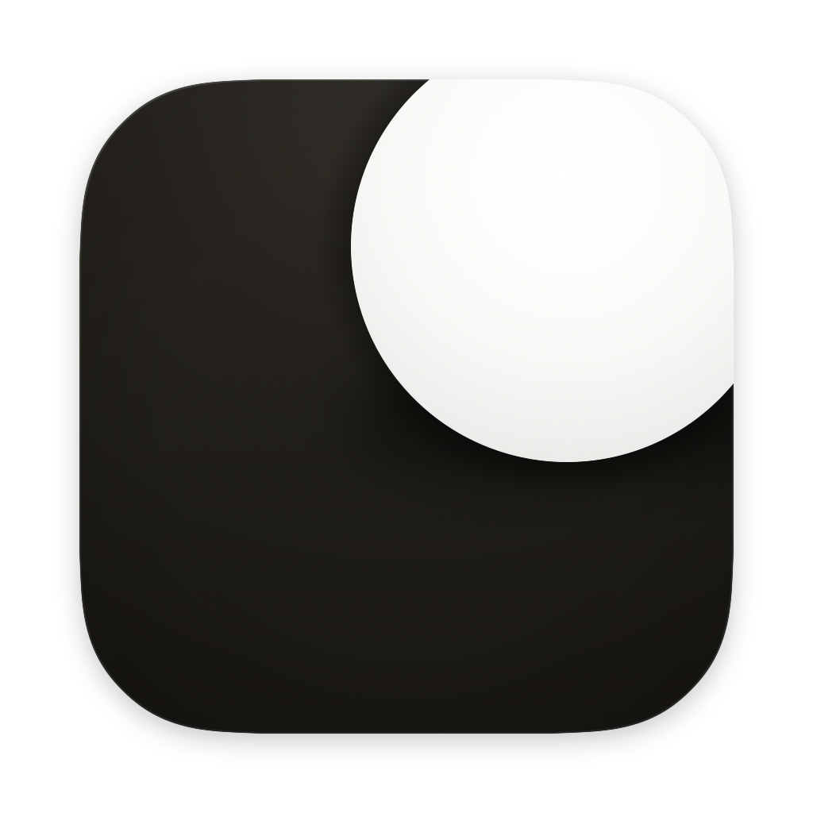

<p align="center">
  
</p>

<h1 align="center">Dot</h1>

<p align="center">
  <strong>Write as fast as you can think.</strong><br>
  Dot turns your speech into text at the cursor, wherever you are working on your Mac.
</p>

<p align="center">
  
  
  <a href="LICENSE"></a>
  <a href="https://buymeacoffee.com/anandlo"></a>
</p>

<p align="center">
  <a href="#install">Install</a> •
  <a href="#quick-start">Quick start</a> •
  <a href="#features">Features</a> •
  <a href="#engines">Engines</a> •
  <a href="#configuration">Configuration</a> •
  <a href="#permissions-and-privacy">Permissions and privacy</a> •
  <a href="#troubleshooting">Troubleshooting</a> •
  <a href="#building-from-source">Building from source</a> •
  <a href="#license">License</a>
</p>

---

Dot is a menu bar app with no Dock icon. Press **⌥⌘D**, speak, and press it again: Dot stops the recording, transcribes it, and puts the text at the cursor in the app you were using. Apple's on-device engine needs no key and no network. Cloud engines use an API key you supply.

## Install

Dot runs on macOS 14 Sonoma or later. Release builds are Apple silicon (arm64); on an Intel Mac, [build from source](#building-from-source). The version in release file names comes from [`VERSION`](VERSION).

No release has been tagged yet. The Homebrew, disk image and curl options below work once one is published; until then, [build from source](#building-from-source).

### Homebrew

```sh
brew install --cask anandlo/tap/dot
```

Homebrew 6.0 and later require a trust decision for a third-party tap; a cask named in full trusts that one cask. If Homebrew cannot find the tap, it is not published yet; use the disk image or the curl installer.

### Disk image

Download `Dot-<version>-arm64.dmg` from [Releases](https://github.com/anandlo/dot/releases), open it, and drag **Dot** to **Applications**. The same release carries `Dot-<version>-arm64.zip` and a `SHA256SUMS` covering both. To check a download:

```sh
shasum -a 256 -c SHA256SUMS
```

### curl

```sh
curl -fsSL https://raw.githubusercontent.com/anandlo/dot/main/scripts/install-remote.sh | sh
```

To install a specific version instead of the newest:

```sh
curl -fsSL https://raw.githubusercontent.com/anandlo/dot/main/scripts/install-remote.sh \
  | DOT_VERSION=<version> sh
```

The script downloads the release zip, checks it against `SHA256SUMS`, confirms the bundle identifies itself as Dot's, verifies the signature, installs to `/Applications`, and loads the LaunchAgent that starts Dot at login. It replaces an existing `Dot.app` only when that bundle can be identified as Dot's. Because curl does not set the quarantine attribute, the app it installs opens without the first-launch Gatekeeper step.

### Uninstall

`brew uninstall --cask dot` removes an app installed by Homebrew. [`scripts/uninstall.sh`](scripts/uninstall.sh) removes the app and its LaunchAgent and leaves your configuration and log in place.

## Quick start

1. Launch Dot. The first launch opens a welcome window where you pick an engine and, if it needs one, paste its API key. Apple Speech needs neither.
2. The dot in the menu bar is the app. Its menu holds the engine and every setting.
3. Press **⌥⌘D** and speak. A card at the top of the screen shows **REC**, a clock and the live level.
4. Press **⌥⌘D** again. The card shows **TRANSCRIBING**, then **PASTED INTO** `<APP>` with the transcript (just **PASTED** when the app cannot be named), or **COPIED** when Dot could not paste.
5. The transcript is on the clipboard either way.

Escape cancels a recording. **⌥⌘V** pastes the last transcript again. **⌃⌥V** opens the dictation palette. To hold the key while you speak instead of pressing it twice, choose **Settings → General → Start and stop → Hold**.

## Features

- **One shortcut, two presses.** ⌥⌘D starts the recording and the second press stops it. The microphone is open only between the two. Hold-to-talk is a setting.
- **Text at the cursor.** Dot puts the transcript on the clipboard, marks it concealed and transient so clipboard managers skip it, and posts ⌘V to the frontmost app. Posting that keystroke is what needs Accessibility.
- **Copy instead of paste.** Without Accessibility, or when Dot itself is frontmost, the transcript stays on the clipboard and the card says **COPIED**.
- **Text while you speak.** With a cloud engine, Dot sends audio in chunks during the recording and commits a chunk at a pause in speech, so committed words never change and the card previews the words still open; the stop sends only the tail. Apple Speech analyzes the finished recording in one pass.
- **Edit on the card.** Click into the transcript on the card to correct it. The clipboard and history take the edited text.
- **Per-app output grammar.** Off by default. When on, the text is fitted to the app receiving it: chat keeps line breaks, code and commit subjects become one line, a document gets an opening capital and a final full stop. History and the clipboard keep your words, and any app can be overridden.
- **Dictation palette.** ⌃⌥V lists recent transcripts with a search field. Return inserts the chosen one at the cursor, Shift-Return copies it, Escape closes.
- **History.** ⌘Y opens the last 20 transcripts with search and copy.
- **Menu bar.** Switch engine, microphone and language, paste or copy the last transcript, and toggle auto-paste, fast record and launch at login.
- **Fast record.** Off by default. When on, a click on the menu bar dot starts and stops a recording; right-click still opens the menu.
- **Microphone.** Choose the input in **Settings → General → Input**. The level meter learns each microphone's room level from your recordings and starts there; Reset forgets one device.
- **Appearance.** Glass or Black card material, system, light or dark windows, and five visualizers: Stretch, Filament, Silk, Matrix and Halo Edge. The card's dwell time is a setting too.
- **Updates.** Check for Updates reads GitHub Releases and links to the release page. Dot does not download or install an update by itself.
- **No account, no backend.** No sign-in, no telemetry, no analytics and no server of ours.

## Engines

| Engine | Runs | Key | What Dot calls |
| :--- | :--- | :--- | :--- |
| **Apple Speech** | On this Mac | None | The system transcriber. Nothing leaves the machine. Needs macOS 26 or later. |
| **OpenAI** | Cloud | Required | `POST /v1/audio/transcriptions` on `api.openai.com`. The model is the one you pick, read from your account's model list or typed by hand. |
| **Groq** | Cloud | Required | OpenAI-compatible transcription on `api.groq.com`. Default `whisper-large-v3-turbo`, with `whisper-large-v3` and `distil-whisper-large-v3-en` listed. |
| **Deepgram** | Cloud | Required | `POST /v1/listen`. Default `nova-3`, with `nova-2` and the specialized Nova models listed. |
| **ElevenLabs** | Cloud | Required | `POST /v1/speech-to-text`. Default `scribe_v2`, with `scribe_v1` and the medical model listed. |
| **Azure Speech** | Cloud | Required | The Cognitive Services REST endpoint for the region you set. Recognition mode, profanity filter and output format are settings. |
| **Xiaomi ASR** | Cloud | Required | The MiMo chat endpoint with an audio part, model `mimo-v2.5-asr`. |
| **Custom endpoint** | Any endpoint you name | Optional | Any service that speaks the OpenAI transcription API. |

Switch engines in **Settings → Provider** or from the menu bar. Where a service publishes a model list, it is read from its own `/models` endpoint once a key is stored; a model id can also be typed.

A cloud endpoint must be `https`. Plain `http` is accepted only for a loopback host: `localhost`, an address in `127.0.0.0/8`, or `::1`.

Audio is recorded as 16 kHz mono PCM16 WAV, and a cloud engine receives it as a WAV upload.

Where a service documents a retention switch, Dot requests zero retention by default: Deepgram `mip_opt_out=true`, ElevenLabs `enable_logging=false`, Azure `storeAudio=false`. These are requests to the service, not guarantees; the service's own policy decides what it keeps.

## Configuration

| What | Where |
| :--- | :--- |
| Settings | The Settings window (**⌘,**) |
| Configuration | `~/Library/Application Support/Dot/config.json` |
| Transcript history | `~/Library/Application Support/Dot/history.json`, last 20 entries |
| Log | `~/Library/Logs/Dot/Dot.log` |
| API keys | Keychain, generic password, service `DOT_API_KEY_<PROVIDER>` |

Dot creates these files `0600` inside folders it creates `0700`. The log is one JSON object per line and is rotated at 5 MB, keeping the newest 1 MB. No API key appears in the configuration, the history or the log.

The main keys in `config.json`:

| Key | Meaning |
| :--- | :--- |
| `provider` | Engine id: `apple`, `openai`, `groq`, `azure`, `deepgram`, `elevenlabs`, `xiaomi` |
| `providers.<id>.model` | Model id; empty uses the engine's default |
| `providers.<id>.baseURL` | Endpoint address |
| `providers.<id>.language` | Language hint, empty lets the engine decide |
| `providers.<id>.authStyle` | `bearer` or `api-key` header |
| `hotkey`, `pasteHotkey`, `paletteHotkey` | Shortcuts, each a key code with its modifiers and label |
| `autoPaste`, `fastRecord` | Delivery and menu bar behavior |
| `recordingMode` | `toggle` or `hold` |
| `maxSegmentSeconds` | Longest request in seconds; `0` uses the engine's own limit |
| `microphoneDeviceUID` | Input device; empty uses the system default |
| `hudMaterial`, `appearance`, `hudVisualizer`, `hudDwellSeconds` | Card and window appearance |
| `logTranscripts` | Whether transcript text may be written to the log |
| `outputGrammarEnabled`, `outputGrammarTargets` | Per-app rewrite and its overrides |
| `microphoneCalibration` | What the meter learned about each input |

Every field has a default. A missing file loads the defaults. A file that cannot be decoded is logged and Dot runs on the defaults. Dot writes the file when a setting changes, so a hand edit is replaced the next time you change something in Settings.

Transcript text reaches the log only when **Log transcripts** is on; otherwise the line records the character count. The log records no key: Dot registers each key it reads as a secret and redacts every string it writes.

## Permissions and privacy

Dot asks for two permissions, each at the moment it first needs it:

- **Microphone**, to record. The prompt appears the first time Dot needs to record, either from the welcome window or from the first recording.
- **Accessibility**, to post the paste keystroke. The prompt appears the first time auto-paste has a transcript to deliver. Without it Dot still transcribes and leaves the text on the clipboard; it does not paste.

**Input Monitoring is never requested.** The shortcut is a Carbon hot key (`RegisterEventHotKey`), which needs no permission, and the release of the key is read from the window server's keyboard state (`CGEventSource.keyState`). Dot installs no event tap.

Nothing else is asked for. There is no Screen Recording request, no Speech Recognition authorization prompt, no analytics and no crash reporting. Dot runs as a single process: the login item starts the same binary, not a helper. The only network requests go to the engine you configured, and to `api.github.com` when you ask for an update check.

The bundle's `Info.plist` also declares usage strings for Automation, Reminders, Calendars and Contacts. Nothing in this release requests them, so no prompt appears.

Audio stays on the Mac with Apple Speech. With a cloud engine it goes to the endpoint you configured. API keys are generic passwords in the Keychain, readable while the keychain is unlocked. Configuration, history and log are files only your user account can read, and the log holds transcript text only when **Log transcripts** is on.

## Troubleshooting

### macOS blocks the first launch

Release builds are signed with Dot's own certificate, not an Apple Developer ID, and they are not notarized, so the first launch is stopped until you allow it:

1. Open **Dot** from `/Applications`. macOS says it cannot verify the app.
2. Open **System Settings → Privacy & Security**, scroll to **Security**, and click **Open Anyway** next to the message about Dot.
3. Confirm with **Open**. macOS remembers the decision.

That button stays for about an hour after a blocked launch. If it is gone, open Dot again and look once more.

### macOS says Dot is damaged and should be moved to the Trash

That is the download quarantine flag meeting a signature Gatekeeper cannot evaluate, not a damaged file. Clear the flag and open Dot again:

```sh
xattr -dr com.apple.quarantine "/Applications/Dot.app"
```

### A Homebrew install is blocked the same way

Homebrew quarantines every cask it downloads, no longer offers `--no-quarantine`, and a cask cannot opt out on your behalf. Use **Open Anyway** as above. The curl lane is the download that never carries the flag, because curl does not set it.

### Permissions after an update

macOS records a grant against the code signature. A build signed with **Dot Self-Signed** keeps the same identity, so the microphone and Accessibility grants survive an update. An ad-hoc build is identified by its own hash, so every rebuild asks again. Create the identity once with [`scripts/signing-identity.sh`](scripts/signing-identity.sh); see [Building from source](#building-from-source).

### Nothing appears at the cursor

- Check **System Settings → Privacy & Security → Accessibility**, and that **Auto-paste** is on.
- If Dot was the frontmost app when the transcript was ready, it copies instead of pasting. The card says **COPIED** and the text is on the clipboard.
- Some apps ignore a synthetic ⌘V. The transcript is on the clipboard, so paste it yourself.
- A cloud engine with a missing or rejected key reports the error on the card instead of a transcript.

### The microphone does not open

- Check **System Settings → Privacy & Security → Microphone**.
- Pick the input in **Settings → General → Input**. A configured device that is no longer connected stays in the list, so choose the one you are actually using.

### The shortcut does nothing

- Another app can already own the combination. Dot shows a message and logs the refusal, and the shortcut stays unregistered; pick another in **Settings → Shortcuts**.
- A shortcut needs ⌘, ⌥ or ⌃ unless it is a function key.
- A password prompt turns on secure input, which hides the key from every app. While it is on, the card says **HOTKEY BLOCKED**. Leave secure input and press again.

### Where to look

**Open log in Finder** in the menu bar menu, or **Settings → About → Open log**, opens `~/Library/Logs/Dot/Dot.log`. For a bug report, include the line from **About Dot**, which gives the version, build and macOS version, and open an issue at [github.com/anandlo/dot/issues](https://github.com/anandlo/dot/issues).

## Building from source

Requires Xcode 16 or later with Swift 6. `Package.swift` declares `swift-tools-version: 6.0` and macOS 14, and the project has no package dependencies.

```sh
git clone https://github.com/anandlo/dot.git
cd dot
swift test
./scripts/build.sh
```

`scripts/build.sh` builds `build/Dot.app` for the host architecture and signs it. To install it to `/Applications` and load the LaunchAgent that starts it at login:

```sh
./scripts/install.sh
```

`./scripts/uninstall.sh` removes the app and the LaunchAgent and leaves the configuration and the log in place.

### Signing

`scripts/build.sh` signs with **Dot Self-Signed** when that identity is installed and ad-hoc when it is not, and prints both the identity it used and the designated requirement that `codesign -dr -` reports. Release artifacts are arm64 because the release workflow runs on GitHub's arm64 macOS runner.

The certificate is what keeps your permission grants across updates. Create it once:

```sh
./scripts/signing-identity.sh
```

The script creates **Dot Self-Signed** in your login keychain, valid for ten years, and every later build signs with it. The first signing run shows one dialog asking whether `codesign` may use the private key; choose **Always Allow**. The certificate has no trust settings, and its private key is restricted to code signing, so it cannot vouch for a website, an email signature or any other app.

Keep a copy if you plan to use the identity for long. A new certificate is a new identity, and every permission has to be granted again:

```sh
./scripts/signing-identity.sh --backup ~/Documents/Dot-Self-Signed.p12
./scripts/signing-identity.sh --import ~/Documents/Dot-Self-Signed.p12
```

An identity that already exists cannot be re-exported by the script, because `security export` cannot name one identity out of a keychain. Export it from Keychain Access instead: **My Certificates**, right-click **Dot Self-Signed**, **Export Items**, format **Personal Information Exchange (.p12)**.

### Release artifacts

```sh
./scripts/release.sh
```

The script builds the app, signs it, verifies the signature, writes `Dot-<version>-<arch>.dmg`, `Dot-<version>-<arch>.zip` and a `SHA256SUMS` covering both, and renders the Homebrew cask from [`dist/homebrew/Casks/dot.rb`](dist/homebrew/Casks/dot.rb) for the artifact it just built. The GitHub Actions workflow runs the tests and then the same script, and attaches those files to the release.

## License

Dot is released under the [MIT License](LICENSE). Copyright 2026 Anand Lo.

Dot is designed and built by Anand Lo, and uses only Apple frameworks, among them AppKit, SwiftUI, AVFoundation, Speech, Carbon, Security and ServiceManagement. There are no third-party packages.

- Website: [dot.anandlo.com](https://dot.anandlo.com)
- Source and issues: [github.com/anandlo/dot](https://github.com/anandlo/dot)
- Support the project: [buymeacoffee.com/anandlo](https://buymeacoffee.com/anandlo)

<p align="center">
  <a href="https://buymeacoffee.com/anandlo"></a>
</p>
