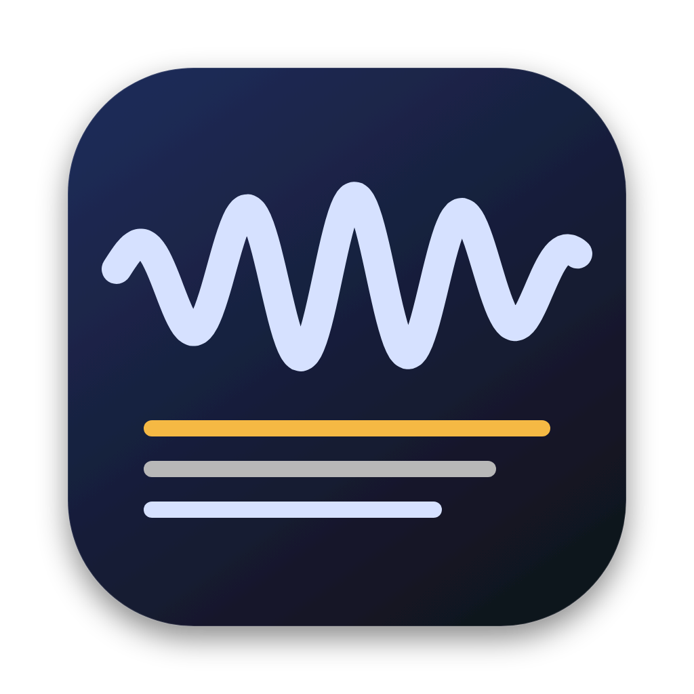

<p align="center">
  
</p>

<h1 align="center">Dot</h1>

<p align="center">
  <strong>Write as fast as you can think.</strong><br>
  <em>Native, push-to-talk voice dictation for macOS (Public Beta v0.1.0-beta)</em>
</p>

<p align="center">
  <a href="https://github.com/anandlo/dot/releases"></a>
  <a href="https://buymeacoffee.com/anandlo"></a>
  <a href="LICENSE"></a>
</p>

<p align="center">
  <a href="#features">Features</a> •
  <a href="#install">Install</a> •
  <a href="#supported-providers">Providers</a> •
  <a href="#shortcuts">Shortcuts</a> •
  <a href="#gatekeeper--security">Gatekeeper Note</a> •
  <a href="#building-from-source">Build</a> •
  <a href="#license">License</a>
</p>

---

## Overview

**Dot** is a lightweight, privacy-focused push-to-talk dictation utility for macOS. Hold your shortcut, speak your thoughts, and release: your words are transcribed and automatically pasted into whatever application you are working in.

Dot is engineered for speed, privacy, and flexibility. It is not locked to any single AI vendor: you bring your own API keys or point to your own local self-hosted speech models.

```
  Hold ⌥⌘D  ──▶  Speak  ──▶  Release  ──▶  Instant Paste (<50ms)
```

---

## Features

- **Sub-50ms Stop Latency**: Uses trailing silence VAD detection to finalize provisional text instantly, eliminating sluggish dual-roundtrip lag.
- **Provider Agnostic**: Switch seamlessly between Apple On-Device Speech, OpenAI, Groq, Deepgram, ElevenLabs, Azure Speech, or any custom OpenAI-compatible server (vLLM, Ollama, Whisper.cpp).
- **Zero Data Retention (ZDR)**: Full support for upstream privacy flags (`mip_opt_out` on Deepgram, `enable_logging: false` on ElevenLabs, `storeAudio=false` on Azure). Custom endpoints feature host-determined retention disclosures.
- **Keychain-Isolated Security**: Secrets and API keys are stored exclusively in macOS Keychain (`DOT_API_KEY_*`). No keys, tokens, or personal identifiers are ever written to disk or logs.
- **Adaptive Spectrogram HUD**: A non-intrusive floating HUD powered by a calibrated 5-band spectrogram that visualizes vocal timbre.
- **True Push-to-Talk**: The microphone records only while the shortcut key is physically held down. The moment you release, recording stops immediately.
- **Native macOS Craftsmanship**: Built with Swift 6, AppKit, SwiftUI, and AVFoundation. Zero Electron, zero webviews, zero heavy dependencies.

---

## Install

### Option A: Direct Download

1. Download the latest `Dot.dmg` from [GitHub Releases](https://github.com/anandlo/dot/releases).
2. Open `Dot.dmg` and drag **Dot** into your **Applications** folder.
3. Open **Dot** from `/Applications`.

> [!NOTE]
> See [Gatekeeper & Security Note](#gatekeeper--security) below if macOS displays an unverified developer prompt on first launch.

### Option B: Homebrew Cask

```bash
brew tap anandlo/tap
brew install --cask dot
```

*(Homebrew automatically clears macOS quarantine attributes, bypassing Gatekeeper prompts cleanly.)*

### Option C: Build & Install from Source

```bash
git clone https://github.com/anandlo/dot.git
cd dot
./scripts/install.sh
```

---

## Supported Providers

Dot lets you configure and switch between providers at any time via **Settings → Provider** or from the menu bar:

| Provider | Engine / Models | Privacy & Data Retention |
| :--- | :--- | :--- |
| **Apple Speech** | Native macOS on-device speech engine | 100% offline. Zero network traffic, zero key required. |
| **Groq** | Whisper Large v3, Whisper Large v3 Turbo, Distil-Whisper | High-speed hosted inference with custom temperature and prompts. |
| **OpenAI** | Whisper (`whisper-1`) | Industry standard transcription API with custom temperature and prompts. |
| **Deepgram** | Nova-2, Nova-3 speech models via `/v1/listen` | Supports Smart Format, Diarization, and Zero Data Retention (`mip_opt_out`). |
| **ElevenLabs** | Scribe v2 speech-to-text API | Supports Diarization, custom keyterms, and Zero Data Retention (`enable_logging: false`). |
| **Azure Speech** | Cognitive Services REST API | Configurable regions (e.g. `eastus`), output format, and zero audio storage (`storeAudio=false`). |
| **Custom Endpoint** | Any OpenAI-compatible transcription or chat audio endpoint | Connect to your self-hosted Whisper, vLLM, Ollama, LM Studio, or private gateways. |

---

## Shortcuts

| Shortcut | Action | Description |
| :--- | :--- | :--- |
| **⌥⌘D** | **Push-to-Talk** | Hold to record audio, release to transcribe and auto-paste. |
| **⌥⌘V** | **Paste Last** | Re-pastes the most recent transcription without recording. |

*Shortcuts can be customized in **Settings → Shortcuts**.*

---

## Gatekeeper & Security

Because Dot is an independent, community-driven open-source project and is not signed with a paid Apple Developer Program enterprise certificate ($99/year), macOS Gatekeeper may present a dialog on first launch stating that Apple cannot check it for malicious software.

### How to open on first launch (Zero-Cost):
1. **Right-click (or Control-click)** `Dot.app` in `/Applications`.
2. Click **Open** from the context menu.
3. In the dialog that appears, click **Open**.

macOS will remember this approval permanently and launch normally thereafter.

Alternatively, you can clear the quarantine attribute via Terminal:
```bash
xattr -cr /Applications/Dot.app
```

---

## Permissions

Dot requests only the permissions strictly required to function:
- **Microphone**: Needed to capture audio while your shortcut is actively held.
- **Accessibility**: Needed only for **Auto-Paste** (synthesizing ⌘V into your active frontmost application).

*Dot does not request Screen Recording permissions and contains zero background analytics or telemetry.*

---

## Building from Source

### Requirements
- macOS 14.0 (Sonoma) or macOS 15.0+ (Sequoia)
- Xcode 15.0+ or Swift 6.0+ Command Line Tools

```bash
# Run unit and integration tests (331 tests)
swift test

# Build debug binary
swift build

# Build release application bundle
./scripts/build.sh

# Package release DMG with SHA-256 checksums
./scripts/release.sh
```

---

## Supporting Dot

Dot is completely free and open source. If Dot saves you time or makes your daily workflow smoother, you can support future development:

<p align="left">
  <a href="https://buymeacoffee.com/anandlo">
    
  </a>
</p>

---

## License

Dot is licensed under the [MIT License](LICENSE).
